# Suricata IDS/NIDS Implementation and Custom Rule-Based Network Threat Detection


## 1. Project Overview

This project involved deploying, configuring, and testing **Suricata**, an open-source Network Intrusion Detection System (NIDS), in a Kali Linux environment.

The implementation focused on establishing network traffic visibility, configuring Suricata's packet capture capabilities, integrating detection rules, monitoring TLS traffic, and developing a custom rule to identify connections to an authorized test domain.

A custom Suricata signature was implemented to inspect TLS Server Name Indication (SNI) metadata and generate an alert when traffic matched the specified domain.

The project demonstrates practical experience with:

- Network intrusion detection and monitoring.
- Packet capture and traffic inspection.
- IDS configuration and rule management.
- TLS protocol metadata analysis.
- Signature-based detection engineering.
- Custom Suricata rule development.
- JSON-based security event analysis.
- Alert verification and evidence documentation.

---

## 2. Project Objectives

The primary objectives were to:

1. Install and configure Suricata on Kali Linux.
2. Identify the active network interface and local network configuration.
3. Configure Suricata to capture network traffic using AF_PACKET.
4. Install and integrate Suricata detection rules.
5. Configure and validate the Suricata YAML configuration.
6. Monitor HTTPS traffic associated with the authorized test domain.
7. Develop a custom rule for TLS SNI-based detection.
8. Generate a controlled detection event.
9. Analyse and verify the resulting alert in Suricata's EVE JSON logs.
10. Document the implementation and supporting evidence.

---

## 3. Laboratory Environment

| Component | Configuration |
|---|---|
| Operating System | Kali Linux |
| Security Tool | Suricata |
| Suricata Version | 8.0.8 RELEASE |
| Network Interface | eth0 |
| Local IPv4 Address | 10.0.2.15 |
| Network Configuration | 10.0.2.0/24 |
| Packet Capture Method | AF_PACKET |
| Detection Engine | Suricata IDS |
| Rules Directory | `/var/lib/suricata/rules/` |
| Main Rules File | `suricata.rules` |
| Custom Rules File | `local.rules` |
| Configuration File | `/etc/suricata/suricata.yaml` |
| EVE JSON Log | `/var/log/suricata/eve.json` |
| Fast Alert Log | `/var/log/suricata/fast.log` |
| Test Domain | `www.codealpha.tech` |

### Network Configuration

The active network interface was identified as:

```text
Interface: eth0
IPv4 Address: 10.0.2.15
Network: 10.0.2.0/24
```

The configured HOME_NET variable included the private network range:

```yaml
HOME_NET: "[192.168.0.0/16,10.0.0.0/8,172.16.0.0/12]"
```

This configuration includes the laboratory host address `10.0.2.15`.

---

## 4. Scope and Authorization

The project used the following domain as its authorized test destination:

```text
https://www.codealpha.tech/
```

The testing focused on ordinary HTTPS connectivity and passive network traffic monitoring.

A custom detection rule was created to identify TLS connections containing the specified domain in their Server Name Indication field.

The custom signature was designed specifically for controlled detection validation.

**Important:** The generated alert represents a successful rule match. It does not indicate that the destination website is malicious or compromised.

---

## 5. Technical Implementation

### Phase 1: Suricata Installation and Version Verification

Suricata was installed and its version verified.

Command:

```bash
suricata --build-info
```

Version verification:

```bash
suricata --version
```

Verified version:

```text
Suricata 8.0.8 RELEASE
```

### Phase 2: Network Interface Identification

The active network interfaces were inspected to identify the interface used for traffic monitoring.

Command:

```bash
ip addr
```

The active interface was:

```text
eth0
```

Assigned IPv4 address:

```text
10.0.2.15/24
```

This interface was subsequently used for Suricata packet capture.

### Phase 3: Suricata Configuration

The primary configuration file was:

```text
/etc/suricata/suricata.yaml
```

The configuration was inspected to verify the network settings, HOME_NET definition, packet capture configuration, and detection rule paths.

The configuration was validated using:

```bash
sudo suricata -T -c /etc/suricata/suricata.yaml
```

Successful validation output:

```text
i: suricata: Configuration provided was successfully loaded. Exiting.
```

This confirmed that Suricata accepted the configuration.

### Phase 4: Detection Rules Installation

The primary detection rules file was located at:

```text
/var/lib/suricata/rules/suricata.rules
```

The rules directory also contained:

```text
classification.config
suricata.rules
local.rules
```

The main ruleset contained approximately 45 MB of rule data.

During the initial ruleset inspection, Suricata reported:

| Metric | Result |
|---|---:|
| Rules Loaded | 53,495 |
| Rules Failed | 0 |
| Rules Skipped | 0 |

These figures were recorded during the initial detection-engine inspection, before the final custom-rule test.

### Phase 5: AF_PACKET Configuration

Suricata was configured to capture traffic through the AF_PACKET capture mechanism.

The configured network interface was:

```text
eth0
```

AF_PACKET provides a packet capture mechanism that allows Suricata to inspect network packets directly from the selected interface.

### Phase 6: EVE JSON Logging

Suricata's EVE JSON logging functionality was enabled.

The primary event log was:

```text
/var/log/suricata/eve.json
```

The configuration included alert event logging.

EVE JSON provides structured security events that can be queried and analysed using tools such as `jq`.

The fast alert log was also available at:

```text
/var/log/suricata/fast.log
```

### Phase 7: Suricata Service Management

The Suricata service was enabled and configured to run through systemd.

Service verification:

```bash
sudo systemctl status suricata
```

The service was confirmed to be:

```text
Active: active (running)
```

The service was restarted after the configuration and local rule integration changes.

---

## 6. Network Traffic Monitoring

After the IDS configuration was completed, normal HTTPS traffic to the authorized test domain was generated.

Command:

```bash
curl -I https://www.codealpha.tech/
```

The request returned:

```text
HTTP/2 200
```

This confirmed that the HTTPS request successfully reached the web server.

Suricata was then used to inspect the corresponding TLS metadata.

The following command extracted TLS events associated with the test domain:

```bash
sudo jq -r '
select(
  .event_type=="tls" and
  .tls.sni=="www.codealpha.tech"
)
| [
  .timestamp,
  .tls.sni,
  .tls.version
]
| @tsv
' /var/log/suricata/eve.json | tail -5
```

The monitoring process demonstrated that Suricata could observe TLS connection metadata, including the requested server name and negotiated TLS version.

**Technical distinction:** Observing TLS metadata is not itself an IDS alert. A detection alert requires a matching rule or detection condition.

---

## 7. Custom Suricata Detection Rule

One of the main technical components of this project was the development of a custom Suricata rule.

The rule was created in:

```text
/var/lib/suricata/rules/local.rules
```

### Custom Rule

```suricata
alert tls $HOME_NET any -> $EXTERNAL_NET 443 (
    msg:"LOCAL CodeAlpha TLS Connection Detected";
    flow:established,to_server;
    tls.sni;
    content:"www.codealpha.tech";
    startswith;
    nocase;
    sid:1000001;
    rev:1;
)
```

### Rule Explanation

| Rule Component | Description |
|---|---|
| `alert` | Generates an alert when the rule matches. |
| `tls` | Identifies TLS protocol traffic. |
| `$HOME_NET` | Represents the configured local network. |
| `any` | Matches any source port. |
| `$EXTERNAL_NET` | Represents the external destination network. |
| `443` | Matches the standard HTTPS destination port. |
| `msg` | Defines the alert message. |
| `flow:established,to_server` | Restricts detection to established traffic travelling towards the server. |
| `tls.sni` | Selects the TLS Server Name Indication inspection buffer. |
| `content` | Specifies the domain string to match. |
| `startswith` | Requires the content match to begin at the start of the selected buffer. |
| `nocase` | Makes the content comparison case-insensitive. |
| `sid:1000001` | Assigns a unique local signature identifier. |
| `rev:1` | Identifies the first revision of the rule. |

### Rule Integration

The local rules file was added to the `rule-files` section of:

```text
/etc/suricata/suricata.yaml
```

The relevant configuration became:

```yaml
default-rule-path: /var/lib/suricata/rules

rule-files:
  - suricata.rules
  - local.rules
```

This ensured that Suricata included the custom rule during detection-engine initialization.

The configuration was subsequently validated successfully.

---

## 8. Controlled Detection Test

After integrating the custom rule, Suricata was restarted and its service status verified.

A normal HTTPS request was generated:

```bash
curl -I https://www.codealpha.tech/
```

The request returned:

```text
HTTP/2 200
```

The EVE JSON log was then queried for alerts generated by the custom signature.

Command:

```bash
sudo jq -r '
select(
  .event_type=="alert" and
  .alert.signature_id==1000001
)
| [
  .timestamp,
  .src_ip,
  .dest_ip,
  .alert.signature
]
| @tsv
' /var/log/suricata/eve.json | tail -5
```

### Verified Detection Output

The following event was successfully recorded:

```text
2026-11-16T16:18:52.518649+0100
10.0.2.15
93.127.179.192
LOCAL CodeAlpha TLS Connection Detected
```

### Detection Analysis

| Field | Observed Value |
|---|---|
| Event Type | alert |
| Timestamp | 2026-11-16 16:18:52 +0100 |
| Source IP | 10.0.2.15 |
| Destination IP | 93.127.179.192 |
| Signature ID | 1000001 |
| Alert Message | LOCAL CodeAlpha TLS Connection Detected |
| Detection Status | Successful |

### Interpretation

The successful alert demonstrates that:

1. Suricata captured the outbound HTTPS traffic.
2. The detection engine inspected the TLS protocol metadata.
3. The TLS SNI value matched the configured domain.
4. The custom signature matched the traffic.
5. Suricata generated an alert.
6. The alert was recorded in the EVE JSON log.
7. The event could be retrieved and analysed using `jq`.

This confirms successful execution of the custom rule-based detection test.

---

## 9. Packet Capture and Detection Statistics

During the initial packet capture inspection, Suricata reported the following statistics:

| Metric | Observed Value |
|---|---:|
| Packets Captured | 201 |
| Kernel Drops | 0 |
| Capture Errors | 0 |
| TLS Flows | 4 |
| Rules Loaded | 53,495 |
| Rules Failed | 0 |
| Rules Skipped | 0 |

These results demonstrated that the capture engine was processing traffic without reported kernel packet drops or capture errors during the inspected period.

The initial `detect.alert` counter was zero because no matching alert had yet been generated at that point.

The later controlled test successfully triggered the custom rule with SID `1000001`.

---
## 10. Screenshots and Technical Evidence

This section presents visual evidence of the Suricata IDS deployment, configuration, network monitoring, custom rule implementation, and successful detection testing performed during the CodeAlpha Cybersecurity Internship.

All screenshots are stored in the `screenshots/` directory of this repository.

### 10.1 Suricata Version and Installation

**Evidence:** `01-suricata-version.png`

Confirms the installed Suricata version and verifies that the IDS software is available in the Kali Linux environment.

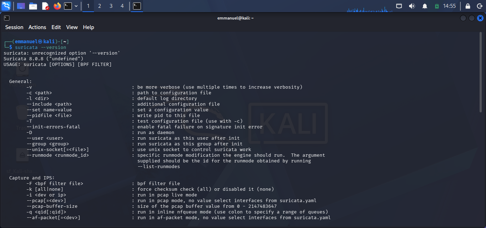

### 10.2 Network Interface Configuration

**Evidence:** `02-network-interface.png`

Shows the network interface used for traffic monitoring, including the assigned IP address and interface details.

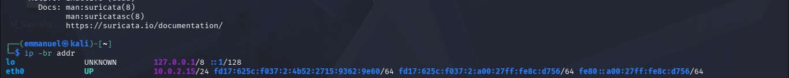

### 10.3 Suricata Configuration Validation

**Evidence:** `03-configuration-test.png`

Demonstrates successful validation of the Suricata configuration file without configuration errors.

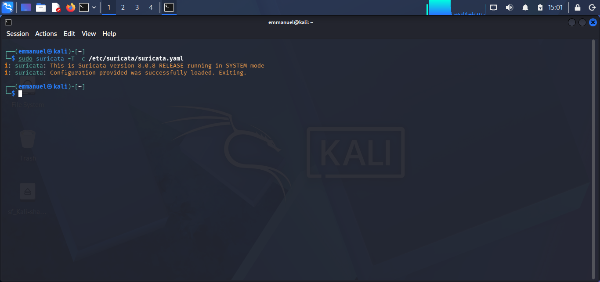

### 10.4 HOME_NET Configuration

**Evidence:** `04-home-network-config.png`

Shows the HOME_NET configuration used to define the monitored internal network.

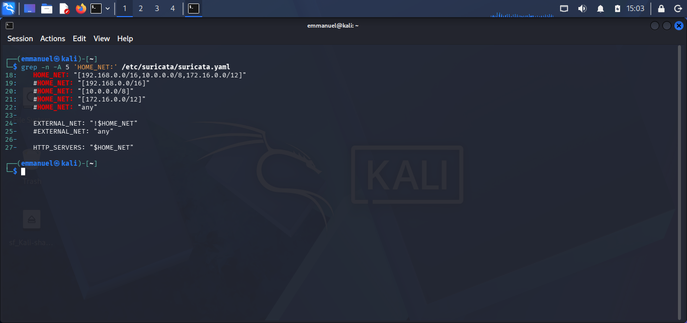

### 10.5 Suricata Detection Rules

**Evidence:** `05-suricata-rules.png`

Displays the configured rule files and custom detection rule used to identify TLS connections to the authorized CodeAlpha test domain.

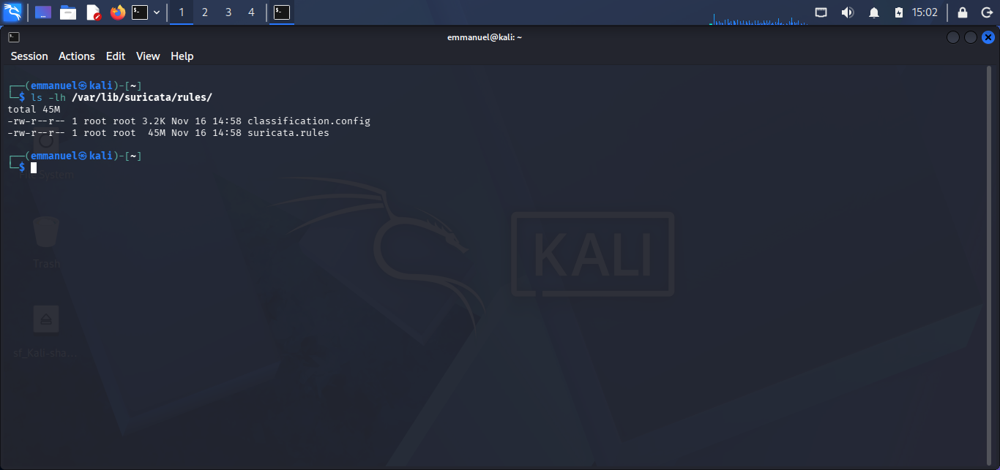

### 10.6 AF_PACKET Network Capture Configuration

**Evidence:** `06-af-packet-config.png`

Shows the AF_PACKET configuration specifying `eth0` as the network interface for packet capture.

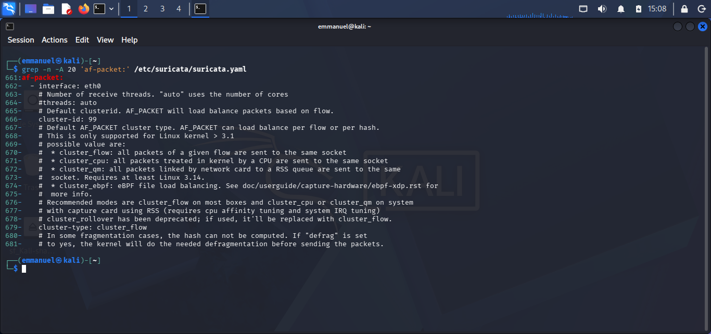

### 10.7 Suricata Service Status

**Evidence:** `07-suricata-running.png`

Confirms that the Suricata service is enabled and running on the Kali Linux system.

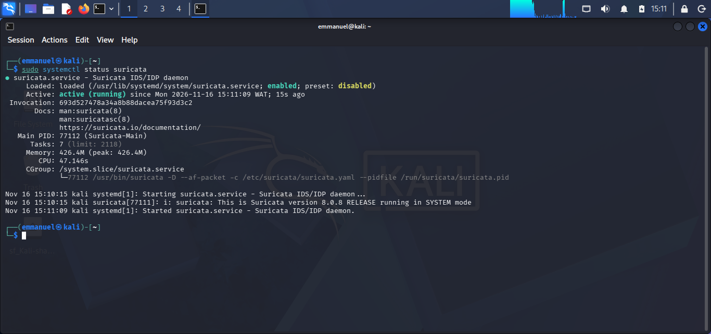

### 10.8 CodeAlpha Website Traffic Monitoring

**Evidence:** `08-codealpha-traffic-monitoring.png`

Demonstrates network traffic generated during the authorized HTTPS connection to `www.codealpha.tech`.

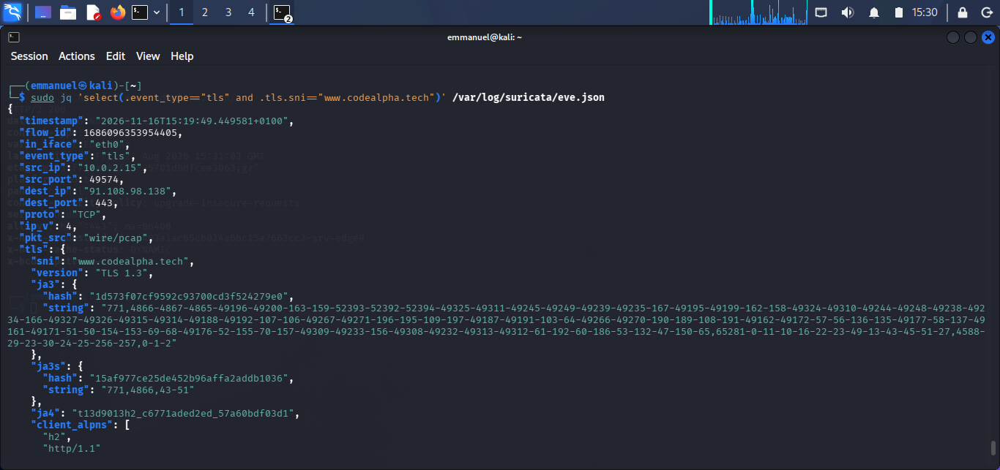

### 10.9 Suricata Packet Statistics

**Evidence:** `09-suricata-packet-statistics.png`

Presents packet-processing statistics collected by Suricata during the monitoring session.

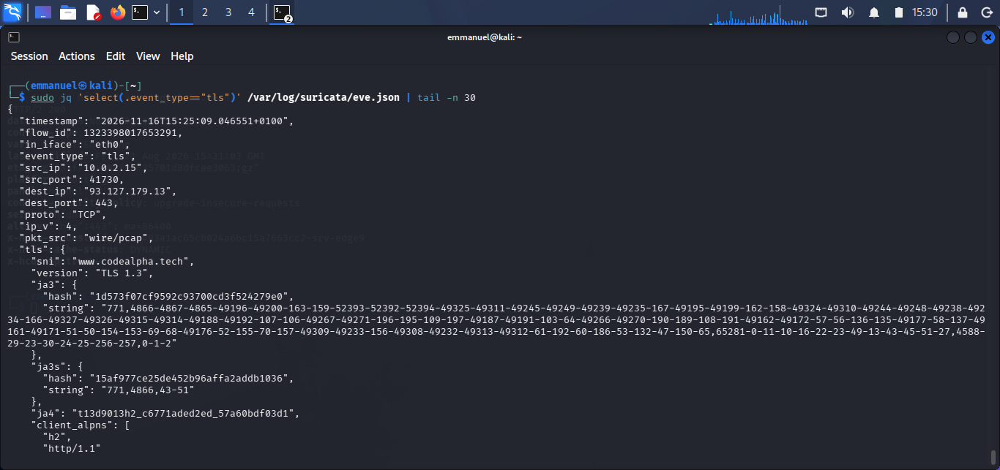

### 10.10 Detection Counters

**Evidence:** `10-suricata-detection-counters.png`

Displays Suricata detection statistics, providing insight into packet processing and alert-generation activity.

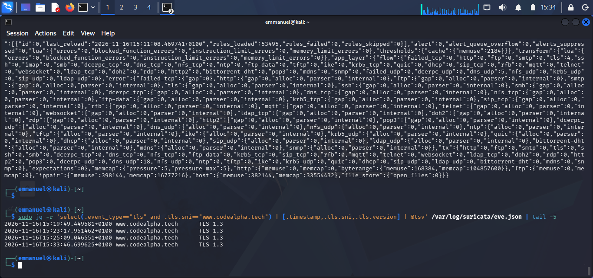

### 10.11 Successful Custom TLS Detection Alert

**Evidence:** `11-codealpha-custom-alert.png`

Shows the successful execution of the custom Suricata TLS detection rule.

The alert confirms that Suricata identified a TLS connection containing the configured Server Name Indication (SNI), `www.codealpha.tech`.

**Detection details:**

- Rule Message: `LOCAL CodeAlpha TLS Connection Detected`
- Signature ID (SID): `1000001`
- Protocol: TLS
- Destination Domain: `www.codealpha.tech`
- Detection Status: Successful

This confirms that the custom detection rule matched the authorized test traffic and generated an alert in the EVE JSON log.

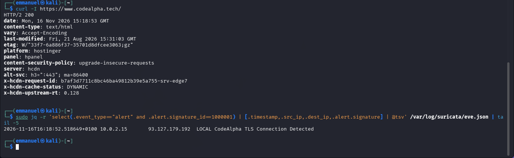

**Evidence Summary:** The screenshots collectively demonstrate the installation, configuration, deployment, traffic monitoring, custom rule implementation, and successful alert generation of the Suricata-based Network Intrusion Detection System.


## 11. Log Analysis and Useful Commands

The following commands were used during the implementation and can also be used for subsequent monitoring.

### Check Suricata Version

```bash
suricata --version
```

### Validate Configuration

```bash
sudo suricata -T -c /etc/suricata/suricata.yaml
```

### Check Service Status

```bash
sudo systemctl status suricata
```

### Monitor EVE JSON Events

```bash
sudo tail -f /var/log/suricata/eve.json
```

### Monitor Fast Alerts

```bash
sudo tail -f /var/log/suricata/fast.log
```

### Extract TLS Events

```bash
sudo jq 'select(.event_type=="tls")' /var/log/suricata/eve.json
```

### Extract Custom Rule Alerts

```bash
sudo jq '
select(
  .event_type=="alert" and
  .alert.signature_id==1000001
)
' /var/log/suricata/eve.json
```

### Inspect Custom Rules

```bash
sudo cat /var/lib/suricata/rules/local.rules
```

### Restart Suricata

```bash
sudo systemctl restart suricata
```

---

## 12. Skills Demonstrated

This implementation provided practical exposure to the following cybersecurity skills:

**Network Security**
- Network traffic monitoring.
- Packet capture.
- Network interface inspection.
- TCP/IP communication analysis.
- HTTPS and TLS traffic inspection.

**Intrusion Detection**
- Suricata deployment and configuration.
- IDS ruleset management.
- Signature-based detection.
- Custom detection rule development.
- Detection-engine validation.

**Security Monitoring and Analysis**
- EVE JSON event analysis.
- TLS SNI inspection.
- Alert extraction with `jq`.
- Detection counter analysis.
- Event verification and documentation.

**Linux Administration**
- Kali Linux command-line operations.
- YAML configuration management.
- Systemd service management.
- Linux log inspection.
- Troubleshooting and configuration validation.

---

## 13. Challenges and Troubleshooting

Several configuration and operational issues were encountered and resolved during implementation.

### Incorrect Rules Directory

Suricata initially referenced:

```text
/var/lib/suricata/rule
```

However, the actual directory was:

```text
/var/lib/suricata/rules
```

The configuration was corrected, after which Suricata successfully validated the rules path.

### Local Rules Integration

The custom detection rule was initially stored separately from the main ruleset.

The `local.rules` file was subsequently included in the YAML `rule-files` configuration.

### VirtualBox Input and Clipboard Issues

Temporary mouse and clipboard integration problems occurred during the laboratory session.

The Kali VM was restarted using:

```bash
sudo reboot
```

The work continued after the virtual machine restarted.

### Initial Absence of Alerts

Although Suricata was capturing traffic and loading its ruleset, the initial detection counter showed zero alerts.

A custom TLS SNI detection rule was therefore implemented and tested using authorized HTTPS traffic.

The rule successfully generated an alert, confirming that the detection engine was functioning as intended.

---

## 14. Project Outcome

The project successfully demonstrated the deployment and configuration of Suricata as a Network Intrusion Detection System in Kali Linux.

The implementation progressed from initial installation and network configuration to packet capture, TLS metadata monitoring, custom signature development, and successful alert generation.

The most significant outcome was the successful execution of a custom TLS SNI-based detection rule with signature ID `1000001`.

The resulting alert was recorded in Suricata's EVE JSON log and independently retrieved using `jq`.

This project strengthened my practical understanding of network intrusion detection, security event monitoring, detection engineering, and Linux-based security tooling.

---

## 15. Conclusion

Deploying an IDS is not simply about installing a security tool. It requires understanding network traffic, configuring the detection engine, integrating appropriate rules, validating the capture mechanism, and confirming that detection events are generated and recorded correctly.

Through this implementation, I gained practical experience configuring Suricata, inspecting TLS metadata, developing custom detection signatures, and analysing security alerts.

The project also reinforced the importance of validating detection logic with controlled tests and maintaining clear technical evidence of each implementation stage.

**Project completed as part of the CodeAlpha Cybersecurity Internship.**

---

## Author

**Emmanuel Idowu**

Cybersecurity | Network Security | Ethical Hacking | Detection Engineering

GitHub: [emmanuel101cyber](https://github.com/emmanuel101cyber)

Main Cybersecurity Projects Repository: [Cybersecurity-Projects](https://github.com/emmanuel101cyber/Main-cybersecurity-portfolio)

---

*Disclaimer: This project was conducted for educational and authorized cybersecurity training purposes. The custom detection rule was designed to identify a specific TLS domain match and does not classify the monitored website as malicious.*
